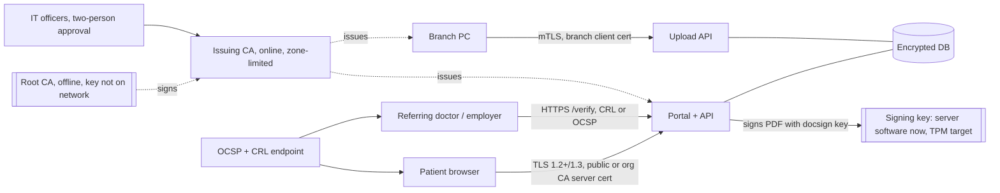

# 1. System, assets, stakeholders and threat model (R1, R2, R3)

## 1.1 Scenario mapping

The guide's scenario is a diagnostic lab. The repository's app is a placeholder with the same shape.

| Scenario role or object | Lab copy in this repository |
|---|---|
| Patient, who views results | customer, `rahim` (customer portal, port 8443) |
| Pathologist's signature on a report | `docsign` certificate, one organisation-level signing certificate (see §B of file 2) |
| Signed report (PDF) | signed account statement, `GET /dl/<token>.pdf` |
| Report QR code and verification page | `/verify/<code>`, `verify_statement.py` |
| Branch collection centre uploading scans | `branch_client.py` to upload service, port 8444 (mutual TLS) |
| Branch front desk staff | `officer.nasrin` (branch view of uploads) |
| IT officers and head of IT | `it.officer` and `head.of.it` (admin, two-person approval) |
| Referring doctor or employer checking a report | anyone with the PDF and its code |

## 1.2 Architecture and data flow: real system



## 1.3 Data flow: lab copy

The lab runs on one host with several ports: 8443 portal (TLS), 8444 branch upload (TLS, client certificate requested), 2560 CRL and OCSP. `make_certs.py` builds the hierarchy. The root key is generated and then discarded, so the lab does not demonstrate a real offline root ceremony. Section 1.5 of file 2 records this as a gap.

Trust boundaries: TB1 internet to portal; TB2 branch network to head office (mTLS); TB3 head-office servers to CA signing keys; TB4 offline root (lab: deleted after use); TB5 verifier (doctor or employer) to the verification page.

## 1.4 Assets (20)

| ID | Asset | Where in lab | Protection |
|---|---|---|---|
| A-01 | Root CA private key | not kept (discarded after signing) | real: offline, two-person ceremony |
| A-02 | Issuing CA private key | `certs/issuing.key` | mode 0600, git-ignored |
| A-03 | Statement signing key (docsign) | `certs/docsign.key` | 0600, git-ignored |
| A-04 | Portal TLS private key | `certs/server.key` | 0600, git-ignored |
| A-05 | Branch client private key | `certs/client-branch-rangpur.key` | 0600, git-ignored |
| A-06 | Timestamp authority key | `certs/tsa.key` | 0600, git-ignored |
| A-07 | OCSP responder key | `certs/ocsp.key` | 0600, git-ignored |
| A-08 | Revocation data | `certs/revoked.json` (source for CRL) | integrity by CRL signature |
| A-09 | Issuance log | `certs/issuance.log` | hash-chained, checked by `check_issuance.py` |
| A-10 | Flask session secret | `.secret` | generated at first run, git-ignored |
| A-11 | Field encryption key | `.fkey` | Fernet, git-ignored |
| A-12 | Signed statement PDFs | issued on download | PAdES-style signature, verified by `verify_statement.py` |
| A-13 | Customer records (balances, transactions) | `lab.db` | git-ignored, NID encrypted |
| A-14 | National ID numbers | `users.nid` | Fernet, shown masked |
| A-15 | Branch uploaded scans | `uploads.blob` | Fernet at rest, checksum checked |
| A-16 | Admin approval records and audit trail | `admin_requests`, `audit` | append-only in app logic |
| A-17 | Refused-attempt log | `refused` table | written on every app-level refusal |
| A-18 | Password hashes and OTP secrets | `users.pw`, OTP in session | hashed, OTP hashed with secret |
| A-19 | Verification codes | `statements` table | random 64-bit codes |
| A-20 | Trust store (root and issuing certificates) | `certs/root.crt`, `ca-bundle.crt` | integrity; copies on each device |

## 1.5 Stakeholders and conflicts

Groups: patients; referring doctors; pathologists; branch staff and front desk; IT officers; management; employers and corporate clients; regulators and law enforcement; the CA itself (as a stakeholder that must be protected from misuse).

Conflicts and how the design handles each:

| # | Conflict | Design response |
|---|---|---|
| C1 | Doctors need fast verification, but fail-open revocation would accept revoked reports | Fail-closed for report verification (file 2 §D); CRL cached with a 2-day next-update; re-check path in the ethics case (file 5 §B) |
| C2 | Pathologists want quick signing, but the signing key must not be misused | One signing certificate with 0600 key file, server-side only; approval flow for revocation; no key leaves the server (file 2 §F) |
| C3 | Branch staff want uploads that just work, but mTLS is strict and one branch PC is too old | Clear error messages (`client certificate required`, `certificate revoked`); old PC blocked and replaced by a supported PC (file 2 §B) |
| C4 | Management wants low cost; TPM or HSM is expensive | Software keys with strict file permissions now; TPM is the target (adaptation plan, file 6) |
| C5 | Employers need proof a report is genuine; patients want privacy | Verification returns only genuine yes/no, last four digits and issue date. No balance, no full account number (test `signing_verify_page_does_not_disclose_balance`). The PDF itself still shows the balance to whoever holds it |

## 1.6 Threat model (STRIDE)

Likelihood and impact are rated L, M, H. Risk is the combination (H×H = critical). Each threat has a control and a test from `7-test-results.md`.

| ID | STRIDE | Threat | L | I | Risk | Control | Test |
|---|---|---|---|---|---|---|---|
| T01 | S | (a) Wrongly issued server certificate for a victim name | M | H | High | Name constraints to `dhanshiri.test`; issuance log with alert; two-person approval | `issuance_out_of_policy_cert_is_flagged` |
| T02 | S | Branch client certificate from an untrusted CA | M | H | High | Chain validation at TLS layer | `chain_upload_untrusted_client_cert_refused` |
| T03 | S | (b) Expired certificate still accepted | M | M | Medium | Validity checked by TLS and app; expiry warning at 30 days | `expiry_expired_client_cert_refused` |
| T04 | S | (b) Revoked certificate still accepted | M | H | High | Revocation list checked on every upload; fail-closed verify | `revocation_revoked_branch_cert_refused_and_logged` |
| T05 | T | Edited report that looks genuine | H | H | Critical | PDF signature covering full byte range; verifier checks signature | `signing_edited_report_fails` |
| T06 | T | Report signed by a revoked key | L | H | High | CRL check in verifier; fail-closed on unknown status | `signing_report_with_revoked_key_is_flagged` |
| T07 | I | (c) Protocol downgrade to TLS 1.0 or 1.1 | M | H | High | TLS 1.2 minimum; no compression; ECDHE+AEAD only | `downgrade_tls11_refused` |
| T08 | I | (c) Weak cipher suite (CBC, RSA key exchange) | M | H | High | Cipher list restricted to ECDHE+AESGCM and ECDHE+CHACHA20 | `downgrade_weak_cipher_refused_and_strong_suite_accepted` |
| T09 | I | Interception with a certificate from an untrusted CA | M | H | High | Clients trust only the lab root; pinned name | `chain_untrusted_ca_rejected` |
| T10 | S | Hostname mismatch (valid cert, wrong name) | M | M | Medium | Clients check the name | `chain_hostname_mismatch_rejected` |
| T11 | I | Theft of a private key from disk or repository | M | H | High | 0600 permissions; git-ignored; offline root; no keys in chat or AI tools | `keys_private_files_mode_0600_and_ignored_by_git` |
| T12 | E | One officer alone revokes or resets (insider, or voice-cloned instruction) | M | H | High | Two-person approval; requester cannot approve | `ai_single_officer_urgent_revocation_refused` |
| T13 | T | Issuance log altered to hide an unapproved certificate | L | H | Medium | Hash chain; check against issued files | `issuance_log_tamper_detected` |
| T14 | R | Unlogged certificate issued outside the process | L | H | Medium | Every file in `certs/` must match a log entry; ALERT if not | `issuance_unlogged_cert_raises_alert` |
| T15 | D | Revocation service down, so valid reports are refused | M | M | Medium | Accepted (fail-closed); CRL mirror and 2-day cache are the mitigation | `revocation_unreachable_crl_fails_closed` |
| T16 | E | Customer account tries admin functions | L | H | Medium | Role check on every admin route | `ai_single_officer_urgent_revocation_refused` (customer part) |
| T17 | S | Branch device uses a server certificate as its client certificate | L | M | Low | EKU check; TLS purpose check | `issuance_wrong_type_server_cert_refused_as_branch_client` |
| T18 | S | Wrong password guessing or OTP guessing | M | M | Medium | OTP hashed; lockout after 5 failures for 5 minutes | `auth_wrong_otp_refused` |
| T19 | S | Upload with no client certificate | H | L | Medium | Refused and logged | `upload_missing_client_cert_refused_and_logged` |
| T20 | S/AI | Deepfake voice asks IT for certificate files (Section 8) | H | H | Critical | Second approver; call-back; no key export | see file 4 |

Residual risks after controls: T05 relies on the verifier actually checking; a printed copy with a stolen code remains a risk (file 2 §E). T15 is accepted by design. T20 depends on people following the process.

## 1.7 Attack trees

### Goal G1: get a trusted portal certificate

```
G1 Trusted portal certificate
├─ G1a Steal the issuing CA key        → A-02 0600, git-ignored, offline root (target TPM)
├─ G1b Get the CA to issue for a victim name
│   ├─ Social-engineer an officer (voice clone) → two-person approval, call-back, file 4
│   ├─ Ask for a name outside the zone        → name constraints, issuance alert (T01)
│   └─ Ask for a long-lived certificate       → policy limits, issuance alert (T01)
├─ G1c Steal the server key from the portal host → 0600, not in repo, short 90-day life
├─ G1d Make clients trust a rogue root         → clients trust only the lab root (T09)
└─ G1e Reuse an expired or revoked certificate → expiry and revocation checks (T03, T04)
```

Controls that stop the path: G1b and G1d need a human step or a client change that the lab detects. G1a and G1c need host access, so file permissions and the offline root raise the cost.

### Goal G2: make a forged report look genuine

```
G2 Forged report looks genuine
├─ G2a Edit the PDF body                 → signature breaks (T05, test)
├─ G2b Copy a real signature to a new PDF → signature covers the file it was made for; check fails
├─ G2c Sign with own key                 → chain to lab root fails (T09 style)
├─ G2d Use the stolen docsign key        → signature valid; revocation list flags it (T06, test)
├─ G2e Show an old, genuine, revoked report → revoked signer flagged; statement codes checked
├─ G2f Fake verification site            → name check on the real site (T10); QR goes to real domain
└─ G2g Print a copy and show it in person → not covered by crypto; verification steps ask for a live check (file 2 §E)
```

Remaining gaps for G2: G2g and the QR code tell the verifier only that the statement is one this lab issued. The verifier must also compare the last four digits, date and name with the report, which the steps in file 2 §E require.
